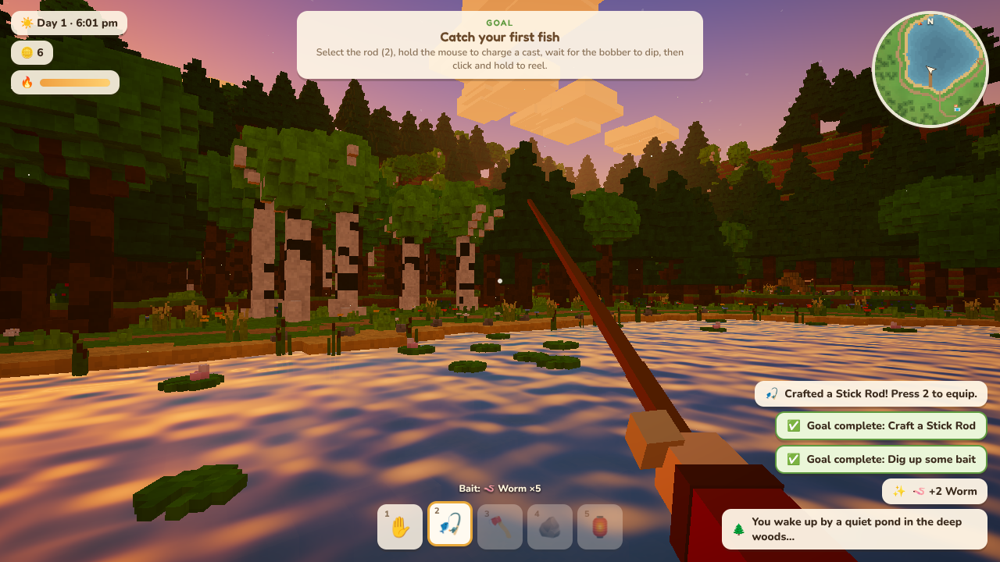
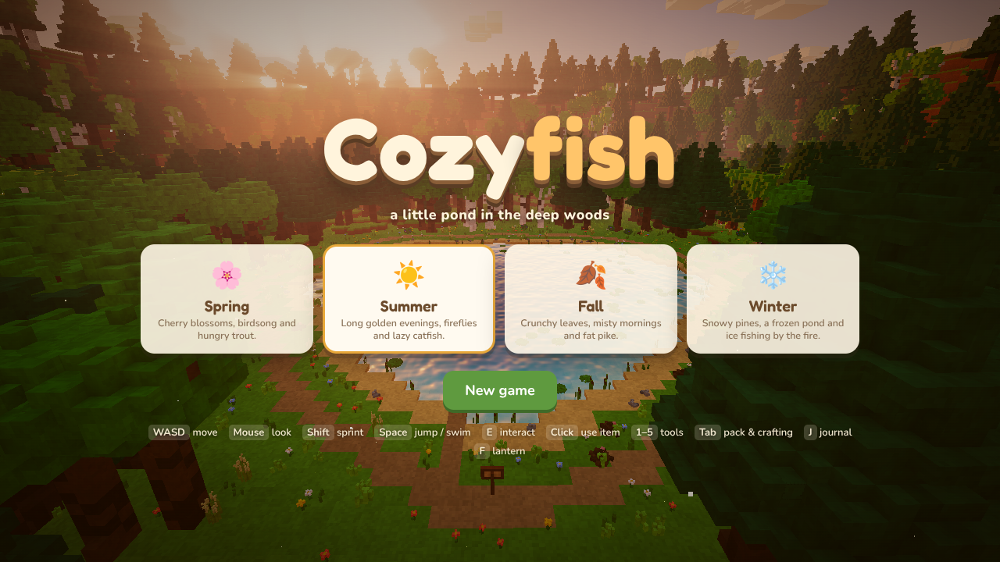
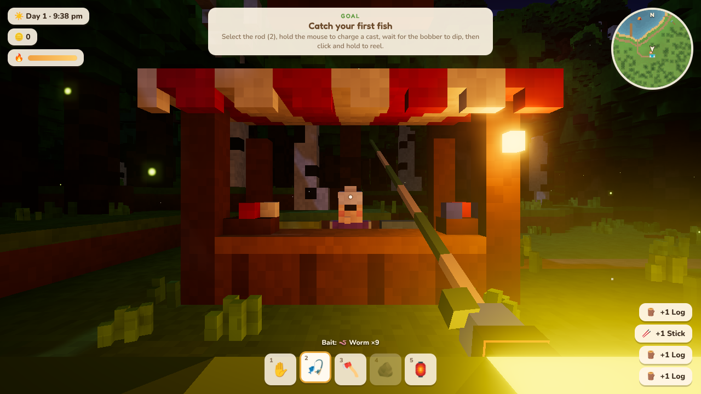

# Cozyfish 🎣

A cozy, warm-glow voxel fishing & survival-lite game that runs in the browser — Three.js, no build step.

Wake up by a quiet pond in the deep woods. Gather sticks and find string to make your first rod, dig up worms,
catch fish and sell them at Mabel's market stand. Upgrade your gear, chop trees, raise a log cabin block by block,
build a rowboat and go after the legendary fish in the deep middle of the pond. Pick the season you want to live in:
spring, summer, fall or winter (ice fishing!).



## Play

Serve the folder with any static file server and open `index.html`:

```sh
python3 -m http.server 8000
# → http://localhost:8000
```

Desktop browser with a mouse and keyboard recommended.

| Key | Action |
|---|---|
| **WASD** | Move (Shift to sprint) |
| **Mouse** | Look (click the game to capture the mouse) |
| **Space** | Jump · swim up |
| **C** | Dive while swimming |
| **E** | Interact / pick up (hold on dirt mounds to dig) |
| **Left click** | Use held item — cast & reel, chop, throw |
| **1–5 / wheel** | Hands · Rod · Axe · Stones · Lantern |
| **Tab** | Pack & crafting |
| **J** | Fish journal |
| **F** | Toggle lantern |
| **Esc** | Pause, settings, change season |

## The loop

1. **Gather** sticks, stones and fiber around the pond. Old crates hide in the woods — the abandoned campsite to
   the north has string.
2. **Craft** a Stick Rod (3 sticks + 1 string). **Dig** worms from dirt mounds for bait.
3. **Fish** — hold to charge a cast, wait for the bobber to plunge (nibbles are fakes!), click to hook, then hold to
   reel. Ease off when the fish pulls or the line snaps.
4. **Sell** at Mabel's stand. **Buy** better rods (Willow → Carbon → Golden), an iron axe, lanterns, nails, lures.
5. **Chop** trees with a Stone Axe — they topple with physics and break into logs (which float if they land in the
   pond). Split logs into planks.
6. **Build** your cabin in four stages (foundation, walls, roof, cozy interior) — then sleep in your own bed.
7. **Build a rowboat** at the dock and fish the deep water. Legendary fish need a Carbon Rod or better.
8. **Fill the journal** — 21 species (and some junk), different in every season, some only at night.

Also: skip stones across the pond, build campfires to warm up (winter and wet clothes are chilly), swim and dive,
watch the ducks, and catch the golden hour — fish bite faster at dusk.

## Code tour

| File | What |
|---|---|
| `src/main.js` | Game state, loop, input, interaction, economy, save/load |
| `src/config.js` | Seasons, items, fish, recipes, shop, building costs, goals — tune the game here |
| `src/terrain.js` | Heightmap voxel world, pond, paths, water/ice shader |
| `src/trees.js` | Instanced choppable trees with fall physics |
| `src/props.js` | Gatherables and ground cover |
| `src/structures.js` | Market, dock, campsite, signs, campfires, house stages |
| `src/player.js` | First-person voxel physics, swimming, held-item view model |
| `src/fishing.js` | Casting, bobber, bites, tension fight |
| `src/boat.js`, `src/life.js` | Rowboat; ducks & jumping fish |
| `src/sky.js`, `src/render.js` | Day/night sky, sun/moon, god rays, bloom, warm grade |
| `src/mesher.js`, `src/models.js` | Voxel mesher with baked AO, pixel-grain shader, all the little models |
| `src/particles.js`, `src/audio.js`, `src/ui.js` | Particles & weather, procedural sound & music, HUD & menus |

`preview.html?season=fall&time=17.5&view=hill` renders still shots of the world (views: shore, aerial, woods, dock,
low, sunset, hill, forest, forest2). `index.html?test` runs the game with a manually stepped clock for automated
playtests (`game.step(n)`).

Progress saves automatically to your browser (localStorage).

## Screenshots





| | |
|---|---|
|  |  |
|  |  |

Three.js r160 is vendored in `vendor/three` (MIT).
