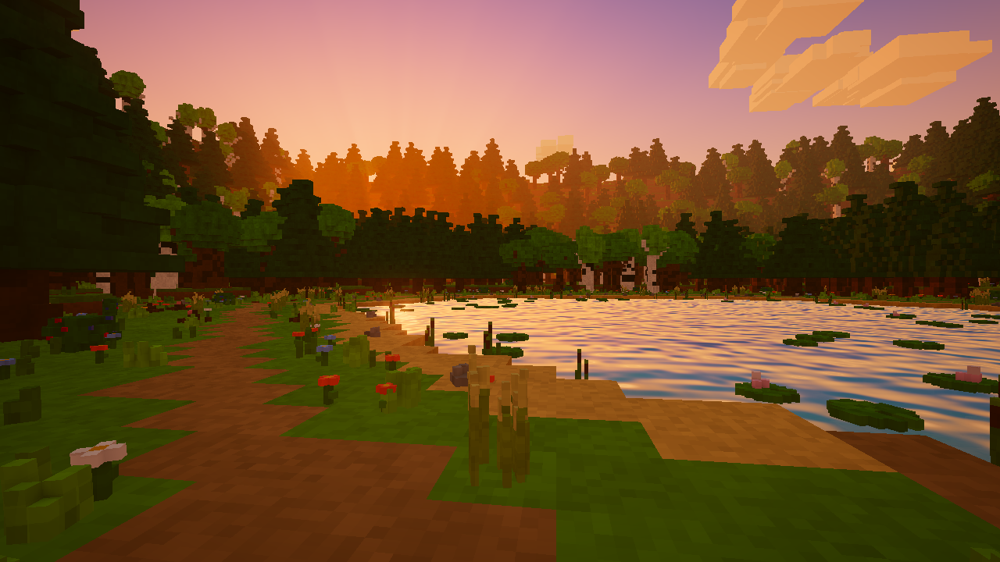
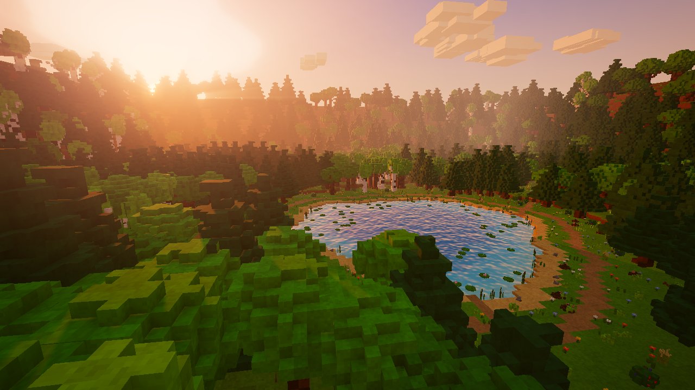
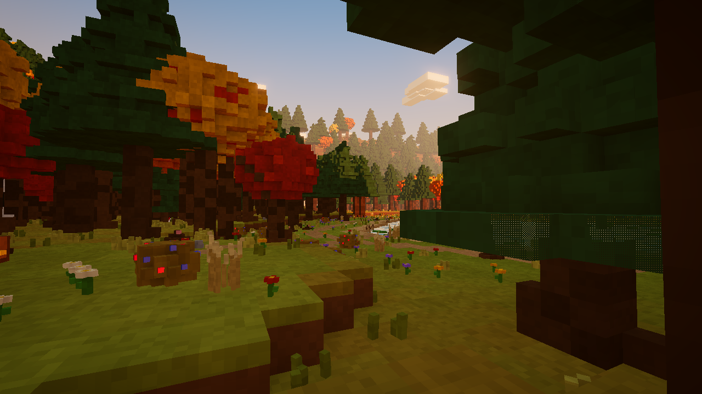
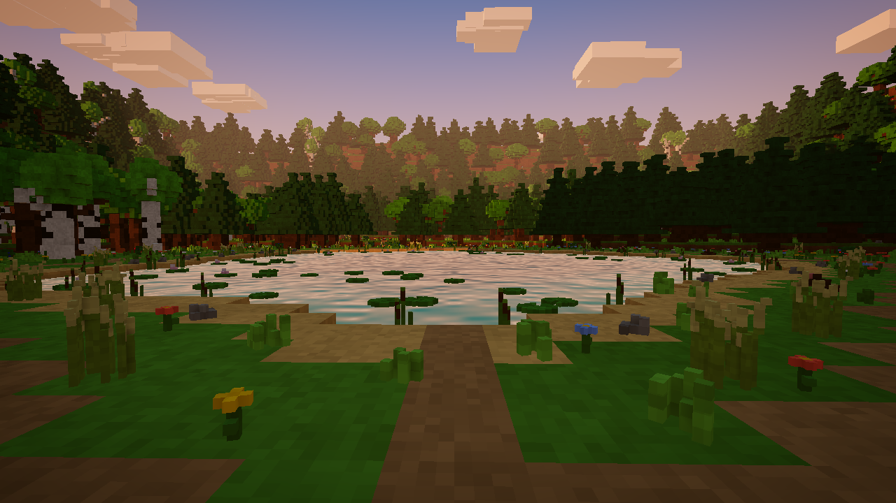
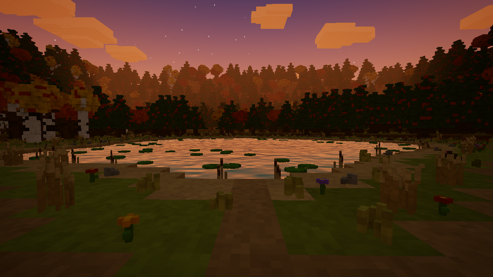
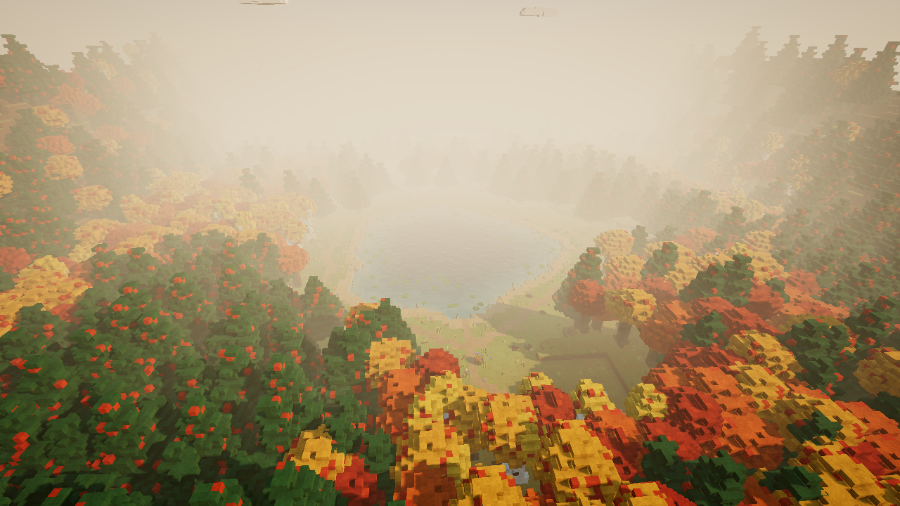
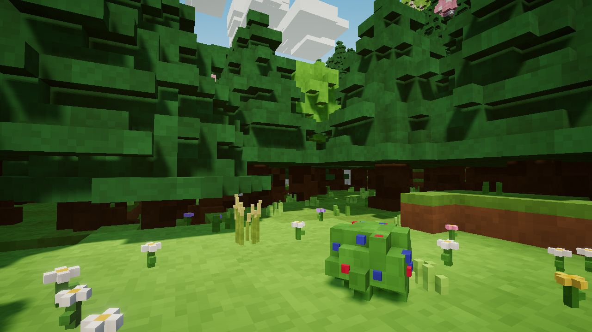
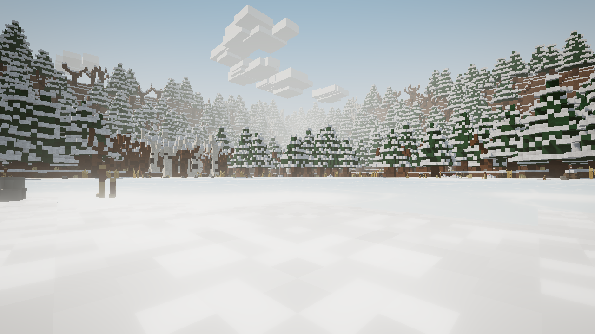
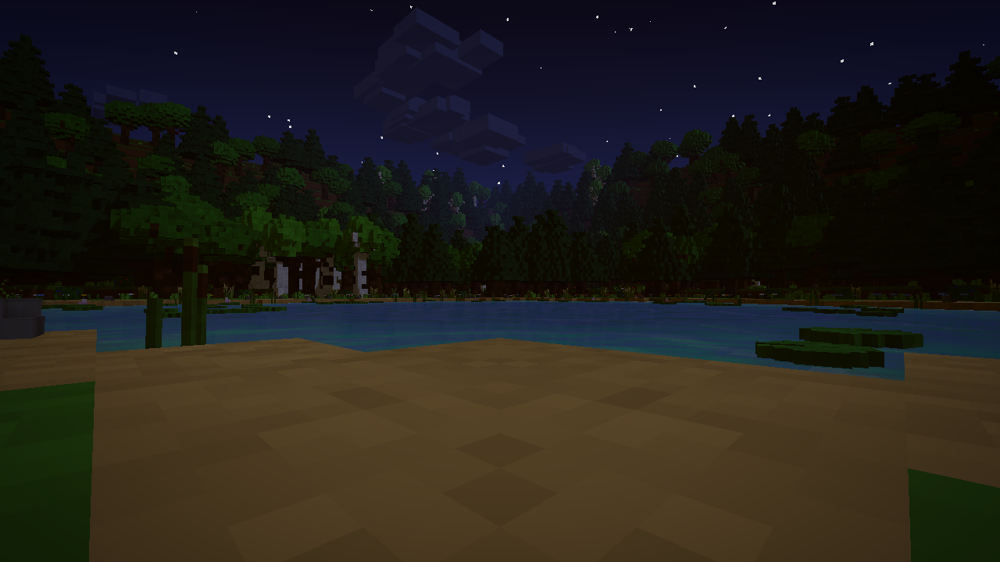

# Cozyfish 🎣

A cozy, warm-glow voxel fishing & survival-lite game that runs in the browser (Three.js, no build step).

Walk around a pond in the deep woods, gather sticks and string to make your first rod, dig for bait, catch fish,
sell them at Mabel's market stand, upgrade your gear, chop trees and build a house — then a boat.
Pick a season to play in: spring, summer, fall or winter (ice fishing!).

## Status

Work in progress — the world, lighting and seasons are in place (see `preview.html`).
Gameplay systems (player, fishing, crafting, building, UI) are next.

## Running

Any static file server works:

```sh
python3 -m http.server 8000
# open http://localhost:8000/preview.html?season=fall&time=18.3&view=shore
```

Preview params: `season` = spring | summer | fall | winter, `time` = hour 0–24, `view` = shore | aerial | woods | dock | low.

## Screenshots






| | |
|---|---|
|  |  |
|  |  |
|  |  |
